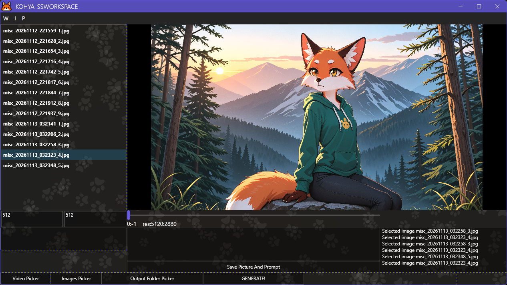
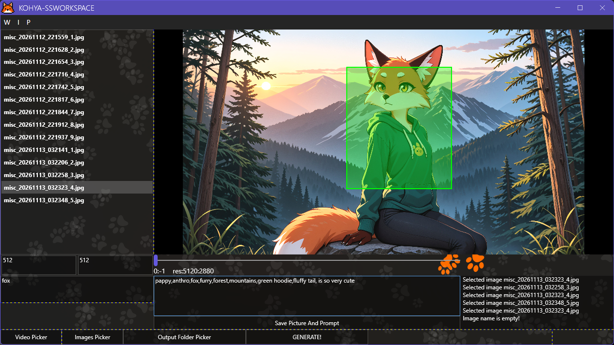

# Video/Image Dataset-Tagger. Kohya-ss Workspace 

## Description

This program is designed to simplify working with images and videos, preparing a dataset for subsequent use with AI.

> The character and the AI-generated image used in the example were created by Kristina Tretyakova/Кристина Третьякова.

## Dependencies

.NET 10.0 (Windows)

Windows 10/11 x64

[FFmpeg](https://github.com/FFmpeg/FFmpeg.git)

## How to use
>Installing dependencies

* Download realese zip archive, unzip it in a convenient location.

* Start `kohya-ss_workspace_WPFver.exe`

* Depending on your needs, select `VIDEO PICKER`. If it is a folder containing images, select `IMAGES PICKER`.

* `Image Name` - your new file name.

* `Resolution W` and `Resolution H` your new resolution. For automatic resize images/frames. If this parameters is not exist, 512x512 will be used by default 

* `Enter prompt` - For enter your prompt, and edit exist prompt.

* You can cropping frame/image

If you crop a frame from a video, it will automatically be added to the list. If the item is an image, then cropping it will apply the crop to the currently selected image.

* A list is positioned on the left edge.  Each time an image is added using the `SAVE PICTURE AND PROMPT` button or cropped, it will be added to the list for further precise work.

* If you load video, you can change frame, slide on timeline

* The log is located at the bottom right. It displays errors and the current status.

* `OUTPUT FOLDER PICKER` Choose output folder, for generate.

* `GENERATE` Button generating in output folder.

##  How to build

To build this project from source, you will need:
* **.NET 10.0 SDK** (or newer)
* **Git** (optional, for cloning the repository)
* **JetBrains Rider** or **Visual Studio 2022** (with .NET desktop development workload)

### Starting `build.bat` or we continue following the instructions

### Restore NuGet dependencies:
`dotnet restore`

### Build the project in Release mode:

`dotnet build -c Release`

### Publish the executable (Self-contained):

`dotnet publish -c Release -r win-x64 --self-contained true`

> Note: The published .exe will be located in bin/Release/net10.0-windows/win-x64/publish/.

### Important notes:

* FFmpeg libraries: Make sure the `runtimes/win-x64/native folder` (containing FFmpeg DLLs) is copied to the build output directory.

* Prefer 32-bit: Ensure that the "Prefer 32-bit" option is turned off in your project settings, as `FFMediaToolkit` requires a 64-bit environment.

## Reporting issue

If you encounter any issues, please create a new issue in this repository.

When reporting a bug, please specify:
1. What exactly went wrong (describe the problem).
2. Steps to reproduce the issue.
3. Your OS and .NET version (if relevant).

## Pull Requests

If you would like to contribute, please:
1. Fork this repository.
2. Create a new branch for your feature/fix.
3. Make your changes and commit them with a clear message.
4. Submit a Pull Request describing what you changed and why.

Please ensure your code follows the existing style and passes the build.

## License

Distribution of the program and source code under the MIT License